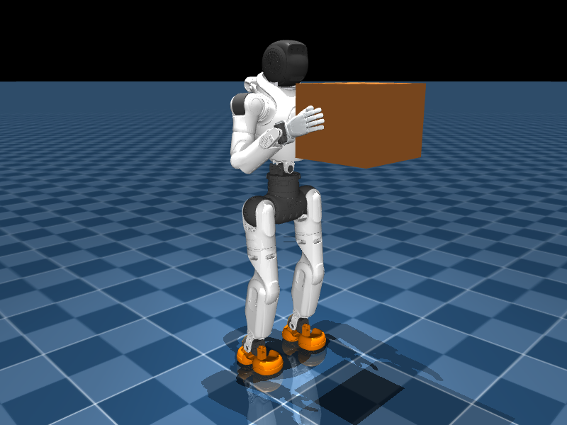
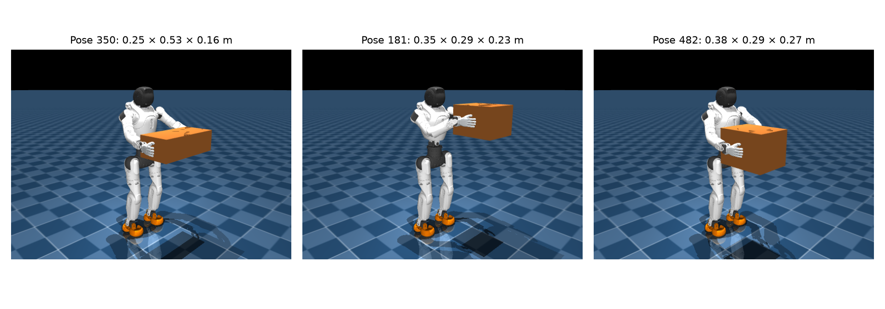

# X2 physical payload playback

Add `--box-mass` (kilograms) to an X2 locomanipulation playback command:

```bash
python scripts/play.py Agibot-X2-Locomanipulation-Carry-Finetune-Flat \
  --checkpoint-file logs/rsl_rl/<run>/model_<iteration>.pt \
  --box-mass 10 --num-envs 1 --viewer native
```

This starts X2 in the F11 carry pose defined in `scripts/play.py`, adds a
free-moving rigid box with mass and inertia, and welds it to both wrist roll
links. Synthetic hand forces are set to zero. The robot and payload reset
together, including randomized root translation and yaw. Keyboard velocity
and height commands remain available; arm-pose switching is disabled while
the box is attached.

`--box-depth 0.3` and `--box-height 0.25` set full dimensions in meters.
Width is fitted between the palms in the carry pose. Omit `--box-mass`
for normal playback. Existing training configurations are unaffected.



The two welds model a rigid grasp and transmit payload weight, translational
inertia, and rotational inertia to the arms. They do not model finger grip,
slipping, or dropping. Contacts with grasping wrist assemblies are excluded
to avoid conflicting contact and weld constraints. Torso, arm, leg, and terrain
contacts remain enabled. The rear face starts at least 3 cm beyond the torso's
visual and collision bounds. The
policy receives the existing robot observations; the box adds no new actor
inputs. Start with a small mass and increase it to assess the checkpoint's
ability to balance and track walking commands.

## Sample the ground-parallel test set

```bash
conda run -n unitree_rl_mjlab python scripts/play.py \
  Agibot-X2-Locomanipulation-Carry-Finetune-Flat \
  --checkpoint-file /path/to/model.pt --box-mass 10 --num-envs 1 --viewer native \
  --carry-pose-file src/assets/data/x2/bones_seed/carry_poses_x2_test_ground_parallel.pkl \
  --box-depth-range 0.2 0.4 --box-height-range 0.15 0.3 \
  --carry-pose-duration 10
```

Play Mode samples a static test pose on each reset. Episodes last 10 seconds
by default; falls also trigger a fresh sample. Press Enter in the native viewer
to reset immediately. Each reset samples depth and height uniformly in the
specified ranges, fits width to palm spacing, and updates the physical box's
dimensions, inertia, position, yaw, and both wrist roll welds. The box mass
stays at `--box-mass`. Dimensions and pose index are printed in the terminal.
The sampled pose is held for the episode, and keyboard arm-pose switching is
disabled. Torso clearance and existing contacts are retained. The simulation
updates size and inertia separately for each environment, including partial
resets; the native viewer displays the current size.

Box orientation follows the line between the palms, so each palm meets the
center of a side face. The sampler first filters poses for the maximum requested
depth and height: all sampled dimensions must fit with 3 cm of torso clearance
without moving the box away from the hand midpoint. Narrow or vertically
misaligned grasps are also excluded. The dataset is unchanged, and the terminal
reports the eligible pose count. Smaller requested boxes can admit more poses.
For the default ranges, 91 of 512 test poses are eligible. Welds anchor at the
side-face grasp points with tighter solver settings. A 1,000-step native-viewer
run of the supplied checkpoint with 10 kg boxes measured a maximum grasp
anchor error of 0.487 mm and relative orientation error of 0.171 degrees.


