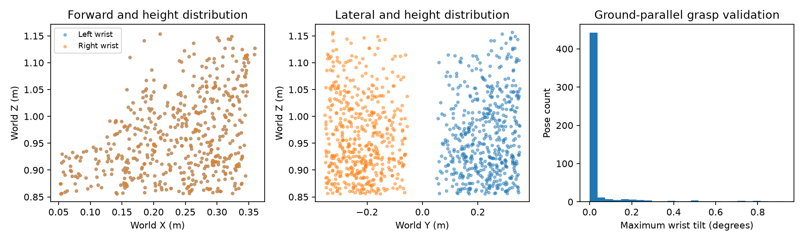

# X2 carry-pose datasets

## Current training dataset

Recorded on 2026-09-28 from the supplied generation parameters:

```bash
--num-poses 512 \
--position-tolerance 0.01 \
--max-end-effector-position-error 0.02 \
--max-parallel-axis-error 0.02 \
--endpoint-offset-lower -0.15 -0.15 -0.15 \
--endpoint-offset-upper 0.15 0.15 0.15
```

Position values are in meters. Endpoint offsets and parallel-axis checks in
the existing generator use the torso frame. Other generation options were
not supplied in this record.

## Ground-parallel test dataset

The test set uses 512 new poses and seed 43, written separately to
`src/assets/data/x2/bones_seed/carry_poses_x2_test_ground_parallel.pkl`.
Its adjacent JSON file records the complete generator configuration.

```bash
conda run -n unitree_rl_mjlab python scripts/generate_x2_carry_pose_dataset.py \
  --ground-parallel --num-poses 512 --seed 43 \
  --position-tolerance 0.01 --orientation-tolerance-deg 1 \
  --max-end-effector-position-error 0.02 \
  --max-parallel-axis-error 0.002 \
  --endpoint-offset-lower -0.15 -0.15 -0.15 \
  --endpoint-offset-upper 0.15 0.15 0.15 \
  --output src/assets/data/x2/bones_seed/carry_poses_x2_test_ground_parallel.pkl
```

In this mode, both endpoint targets share world height and forward position
in a horizontal frame aligned to the torso's heading. Both grasp orientations
use a shared yaw, with the wrist roll links' local +X axes pointing vertically
up and their palm-facing -Z axes horizontal. Pitch and roll are not sampled.
The tilted reference pose is used only to initialize IK and is not saved.

Every saved float32 pose must meet the 2 mm endpoint alignment limit, the
1 degree maximum wrist tilt from world up, joint limits, and the existing
self-collision check. These are finite numerical tolerances, not exact
mathematical equality. Training data is not overwritten.

Validation of the generated 512 poses in Conda found a maximum hand-height
difference of 0.569 mm, maximum forward-alignment error of 0.654 mm, and maximum
wrist tilt of 0.926 degrees. All saved poses passed joint-limit and
self-collision checks. There were no exact pose duplicates in the current
training file. The `.validation.json` sidecar contains these measured results.



To inspect the test set:

```bash
conda run -n unitree_rl_mjlab python scripts/generate_x2_carry_pose_dataset.py \
  --playback-file src/assets/data/x2/bones_seed/carry_poses_x2_test_ground_parallel.pkl \
  --playback-once
```
