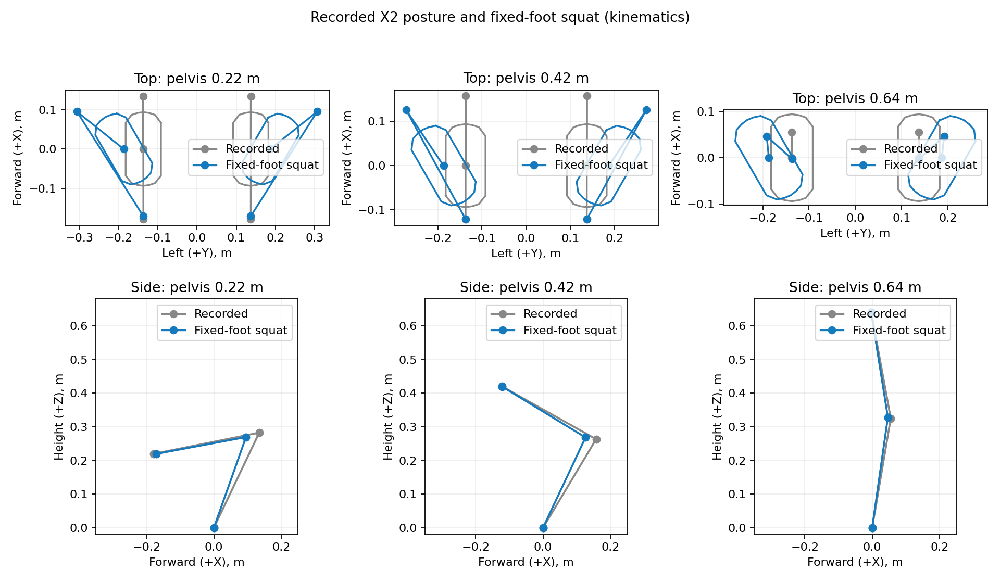

# X2 standing squat with fixed feet

Standing posture rewards use `scripts/postures_x2_knees_out.py`; walking and
running retain `scripts/postures_x2_recorded.py`. Rewards keep their existing
nearest-height lookup. This change adds no interpolation or intermediate poses.

The standing squat uses a constant **0.374 m separation between sole support
centroids**, with **30 degrees of toe-out per foot**, over pelvis heights
**0.22–0.64 m**. The wider stance is established at the standing endpoint.
Every generated reference pose uses the same sole positions and orientations.

## Generation

The generator reads the recorded table without modifying it. It requires
sagittal symmetry, solves six bounded leg angles, mirrors them with the robot's
joint mapping, and independently checks both feet. Recorded waist angles and
grounded pelvis orientation are retained. Fore/aft pelvis translation is allowed;
lateral translation and yaw remain fixed.

For each height, bounded IK first tries the recorded pelvis position or an
adjacent accepted offset. If necessary, it searches offsets in 2.5 mm increments,
up to 0.10 m in either direction. It also checks the exact configured limits;
if the coarse search fails, it bisects the gaps until they are at most 0.1 mm.
This refines the pelvis-offset search only, without adding height samples or
interpolating postures. Recorded and adjacent poses provide seeds.
Knee outward displacement, retraction, joint similarity, and smoothness rank
feasible candidates as preferences. Knee offsets are not mandatory, and leg
pitch changes are bounded by the MJCF joint limits rather than a fixed deviation
from the recording. Optimizer termination is reported separately from measured
feasibility.

Reference tables may include additional named robot joints, such as elbows.
Their values are applied during grounding and validation and retained in the
exported table. References containing only leg and waist joints retain the
existing 15-joint format.

The shipped result contains exactly the 22 original height samples. Only the
0.22 m sample required an additional fore/aft pelvis shift (7.5 mm). Original
waist values are exported exactly. Solved leg angles are exported to six
decimal places.

Use the repository's Python 3.11 environment:

```bash
.venv/bin/python scripts/generate_knees_out_postures.py \
  --reference scripts/postures_x2_recorded.py \
  --output /tmp/postures_x2_knees_out.py \
  --report /tmp/postures_x2_knees_out.json \
  --plot /tmp/x2_knees_out_postures.png
```

Existing output paths require `--overwrite`. Reference, table, report, and plot
paths must be distinct. To regenerate the shipped table, select
`--output scripts/postures_x2_knees_out.py --overwrite`.
No table is written until the entire generation and validation succeed.
Failures report the height and measured residuals without replacing outputs.

## Per-pose export validation

The exported Python table is executed and reloaded through the playback
grounding convention. Each pose is also checked after conversion to float32,
as used by the posture rewards. Internal acceptance uses 0.16 mm positional/height
and 0.04 degree angular tolerances, leaving margin below the public limits:

| Quantity | Limit | Shipped validation |
| --- | --- | --- |
| Sole support-point position error | 0.2 mm | Below 0.001 mm |
| Foot orientation error | 0.05 degrees | Below 0.001 degrees |
| Pelvis height error | 0.2 mm | Below 0.020 mm |
| Pelvis orientation change | 0.05 degrees | Below 0.001 degrees |
| Self-penetration | 1 mm | None detected |
| Unloaded COM support margin | Nonnegative | At least 47.7 mm |

The generation report records per-pose foot geometry, target geometry, pelvis
shift, knee offsets, joint limits, support margins, optimizer status, and worst
float32 pose errors. All 22 generated poses remain within the MJCF hard limits.
These checks cover the discrete reference poses; motion between them is not
validated by this generator.

```bash
.venv/bin/python scripts/playback_height_postures.py scripts/postures_x2_knees_out.py --validate-only
.venv/bin/python scripts/playback_height_postures.py scripts/postures_x2_knees_out.py --once
```



The plotted chains connect hip-roll origins, knee origins, and foot support
centroids. The sole datum remains the existing capsule **centerline endpoints**;
capsule radii are not included. This is consistent with the existing height
labels and does not recalibrate physical sole height.

These results establish sampled kinematic feasibility and unloaded static
support. Playback sets joint poses rather than simulating the forces required
to move between them. Policy evaluation is still needed to validate ground
friction, torque, disturbances, load carrying, and transitions from walking.
Changing reward references requires retraining or fine-tuning; it does not
change an existing policy's behavior by itself.

## Recorded baseline

The original CSV can still be resampled independently:

```bash
.venv/bin/python scripts/resample_height_postures.py scripts/height_postures.csv \
  --output /tmp/postures_x2_recorded.py
```

The resampler symmetrizes leg pitch, zeroes leg roll/yaw and waist yaw/roll, and
uses grounded heights. The checked-in baseline includes zero waist-pitch
targets over 0.60–0.64 m, unlike the small negative values in the raw CSV.
The squat generator uses that checked-in baseline by default.
