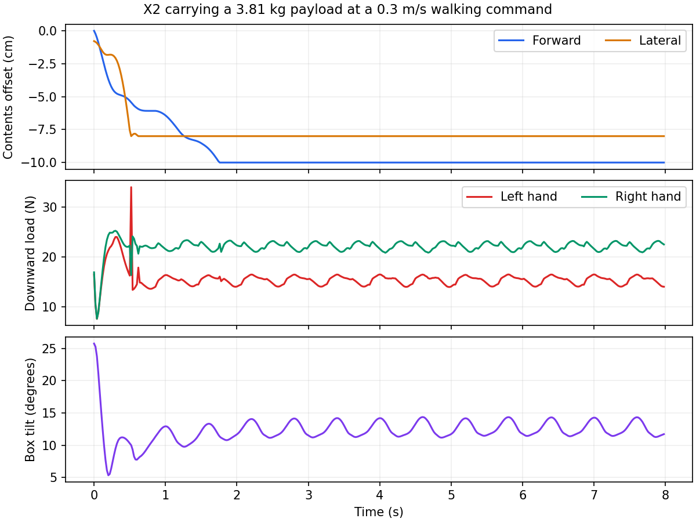

# X2 carrying payload

`SlidingBoxForceEvent` in `src/tasks/locomanipulation/mdp/payload.py` models a
hand-carried box with one aggregate mass sliding on its floor. It is enabled
only in `Agibot-X2-Locomanipulation-Carry-Finetune-Flat`. Basic flat/rough tasks
retain their existing force events and general manipulation data.

The event uses batched Torch operations once per 20 ms policy step. It adds no
MuJoCo bodies, contacts, constraints or physics substeps. The bounded task adds
two hand Jacobians for full-wrench torque estimation. Observations, rewards and
symmetry retain their dimensions and definitions.

## Torque-aware applied wrenches

New carry training extends the original `MaxForceEstimator` with a full bilateral
wrench limiter and a 90% effort envelope on the 14 arm joints. Mass is sampled
once per episode from the configured interval within 0–6 kg. Fixed zero and fixed
six are valid. Pose sampling and internal shell/contents dynamics are unchanged.

At each policy step, current COM Jacobians map world-frame forces and torques:
`Q = sum_h(Jv_h.T @ F_h + Jw_h.T @ T_h)`. Holding the current state and
acceleration fixed, replacing the previously applied wrench requires
`tau_new = tau_current + Q_previous_applied - alpha * Q_requested`.
For every selected joint, the signed inequalities
`lower <= tau_new <= upper` define an interval in `alpha`. The solver intersects
all intervals with [0, 1] and chooses the largest feasible value. Zero coefficients
are handled without division by zero. One scale multiplies all six wrench
components on both hands, including shared-joint contributions.

Limits are read from live native force ranges, joint sum ranges and software
limits, including per-environment randomization, before applying the reserve.
The supported mapping is one direct unit-gear hinge actuator per constrained
joint. Jacobian queries do not modify the live dynamics state. The previous
wrench is the actual applied load, so repeated clipping does not count an
unapplied request as support.

An empty interval returns zero load and an infeasibility flag. This fallback
cannot remove a pre-existing overload when no load scale is feasible. The
estimate is instantaneous and conditional on unchanged acceleration; it does
not guarantee actual closed-loop torque, future tracking or grasp stability.
Clipped wrenches represent a bounded disturbance and need not equal the full
reaction of the sampled physical mass. Internal payload dynamics still use the
sampled mass and existing curriculum multiplier.

Every loaded step logs requested/applied force and torque norms, mass, wrench
scale, infeasibility, non-finite requests and actual loaded fraction. Rejected
requests explicitly produce zero forces and torques, including NaN/Inf inputs.
Undefined request norms log zero and are identified by the non-finite metric.
Explicit constant-force overrides retain their existing bypass; physical-box
playback disables the reduced load to prevent double loading.

Flat-to-carry transfers start a fresh load ramp. Carry resumes preserve the saved
`carry_force_start_step`, including when payload settings change.
Bounds are restored with saved train/play/eval settings.
Legacy playback/evaluation metadata without bounds disables them; a legacy
training transfer keeps the new task's bounds. Setting `torque_bounds` to `None`
or its `enabled` field to `False` disables wrench limiting.

## Mechanics and settings

The midpoint follows the wrist-roll COMs. The box lateral axis follows the hand
span; its up direction comes from the two wrist links' local +X directions,
projected perpendicular to the span. This matches the X2 carry dataset's side-
grasp convention. Averaging those directions approximates a shared rigid grasp.

The contents feel gravity and the box's translational, Euler, centripetal and
Coriolis accelerations. Resting contents stick up to the static-friction limit;
sliding uses lower kinetic friction. Friction depends on estimated normal load.
Damping is implicit, with no spring pulling contents toward the center. Wall
impacts reverse outward speed according to restitution and transfer the full
velocity-change impulse into the hand reactions.

Shell/contents reactions, their lever-arm moments, and shell rotational inertia
produce one total wrench. The two hand forces and residual hand torques reproduce
that wrench. Hand load sharing is an explicit approximation, not a solved grasp.
Inertia and visualization use the same box dimensions, including narrow grasps.

Physical settings come from `default_payload_params()` and are saved in environment
YAML and restored by train/play/eval. Episode sampling is configured separately:

| Setting | Default |
| --- | --- |
| Requested mass range / moving contents fraction | 0–6 kg / 75%; uniform within the configured interval |
| Contents travel | +/-10 cm forward, +/-8 cm lateral |
| Static / kinetic friction | 0.15 / 0.10 |
| Wall restitution / damping | 0.10 / 1 per second |
| Initial contents offset / relative velocity | Uniform +/-1 cm / zero |
| Acceleration filter time constant | 0.10 s |
| Default-pose training episodes (always unloaded) | 15% |
| Total unloaded training episodes (`no_force_ratio`) | 30% |
| Unloaded carry-pose training episodes | 15% |

The shell center is 5 cm below the hand midpoint along box up. The box is 12 cm
high, 25 cm deep by default, and wide enough for the hand span and contents
travel. The contents marker has a 2.5 cm radius and rests on the bottom, 3.5 cm
below the shell center. Geometry and friction are exploratory assumptions.

`force_scale` scales both mass components. Zero scale and unloaded episodes emit
zero wrenches. Fine-tuning holds the robot's `HOME_KEYFRAME` upper-body pose for
15% of episodes to rehearse ordinary unloaded locomotion. This differs from the
zero-joint arm pose used by default playback. The fraction stays fixed throughout
fine-tuning; `actions.upper_body_motion.default_pose_ratio` can adjust it.
The hand event reads the action's sampled-default mask and always clears both
forces and torques for those environments, including when constant forces are
configured. For the sliding payload event, `no_force_ratio` is the total unloaded
episode fraction, including default poses. The carry-pose unloaded probability is
`(no_force_ratio - default_pose_ratio) / (1 - default_pose_ratio)`: with the
defaults, 15% of all episodes are unloaded default poses, 15% are unloaded carry
poses, and 70% are load eligible, before geometry checks or the force ramp.
Random load sampling requires `0 <= default_pose_ratio <= no_force_ratio <= 1`;
an explicit fixed pose samples no default episodes. Training restore validates
this budget before changing payload settings. Other training disturbances,
including velocity pushes, still apply.

Constant-force presets bypass random load sampling and payload dynamics, while
sampled default poses remain unloaded. The physical-box playback option disables
the reduced load to prevent double loading.
Partial resets clear only the selected environments' state and wrenches; the
first active sample initializes derivative history without an acceleration spike.

Only the current tilting model is retained. Physical settings contain parameters
without a version tag; restore discards the obsolete tag in previously saved
settings. Missing or unexpected parameter fields fail explicitly.

## Visualization

```bash
cd /home/ubuntu/unitree_rl_mjlab
PYTHONPATH='' .venv/bin/python scripts/play.py \
  Agibot-X2-Locomanipulation-Carry-Finetune-Flat \
  --checkpoint-file logs/rsl_rl/x2_locomanipulation/2026-09-28_13-06-08_carry-finetune-w-default-pose-0.2-2/model_20000.pt \
  --sliding-payload True --num-envs 1 --viewer native --device cpu
```

Restart playback after code changes. Without `--sliding-payload True`, playback
keeps its zero-force default. The option samples carrying poses and holds each
until reset; it cannot be combined with `--box-mass`. Use `--viewer viser` for a
browser viewer.

The translucent brown box follows inferred tilt, the orange sphere shows the
contents, the cyan marker and raised indicator show combined COM, and magenta
arrows show hand forces. These are display-only overlays at true scale.

Native controls: `R` toggles overlays, Space pauses, Enter samples another pose
and load. Numpad 8/2 changes forward/backward velocity, 4/6 changes sideways
velocity, 7/9 changes yaw velocity, and 5 stops. Contents can legitimately stick
or settle against a wall when the applied acceleration and tilt remain steady.

Evaluation accepts `--force-conditions none payload --body-poses x2_carry`.

## Verification and limits

```bash
env PYTHONPATH='' MPLCONFIGDIR=/tmp/mjlab-review-mpl \
  WARP_CACHE_PATH=/tmp/mjlab-payload-warp PYTEST_DISABLE_PLUGIN_AUTOLOAD=1 \
  .venv/bin/python -m pytest tests -q -p no:launch_testing
```

The tests cover friction and tilt, rotation/inertia, wall impulses, wrench
conservation, reset isolation, configuration restore, basic-task isolation,
visualization and headless environment integration. Review also checks invalid
restore atomicity, unloaded episode budgets, constant-force reset overrides and
consistent inertia/display geometry for narrow grasps.
Torque-bound tests additionally check signed scale intervals, coupled hand
forces and torques, previous applied load compensation, independent MuJoCo
wrench mappings, live per-world limits, zero mass, reset isolation and
checkpoint resume behavior. GPU validation exercises batched environments
and short PPO training; these checks do not establish carrying stability.

Validation on 2026-10-28: **368 passed, 16 skipped** in the full CPU suite;
**21 passed** in the torque-bound tests with CUDA available. Ruff and
`git diff --check` passed. An RTX 4090 Laptop GPU smoke run covered 256
environments for 96 steps, 4,096 environments for eight steps, fixed 0/6 kg
loads, partial resets, two PPO updates at full payload scale, flat-checkpoint transfer, ONNX export
and a fresh carry-checkpoint resume. Observations, rewards and learned
parameters remained finite. Every feasible estimate was checked against its
joint-effort bounds. The 256-environment bounded case exercised 1,079 clipped
and 35 infeasible environment steps.
The non-finite fallback regression covers NaN and both infinities in forces and
torques, active/inactive environments, isolation and recovery. Six additional
cases passed with the real estimator and event on CUDA.



This remains a reduced floor-contact model: no vertical flight, rolling/spin,
multiple-object collisions, finger friction, dropping or deformation. Degenerate,
too-small or near-inverted grasps disable loading through the existing unloaded
mask. The 20 ms coupling and finite-difference acceleration estimates are
approximations. CPU regression checks and a finite policy trial do not establish
full GPU training throughput or general carrying stability.
